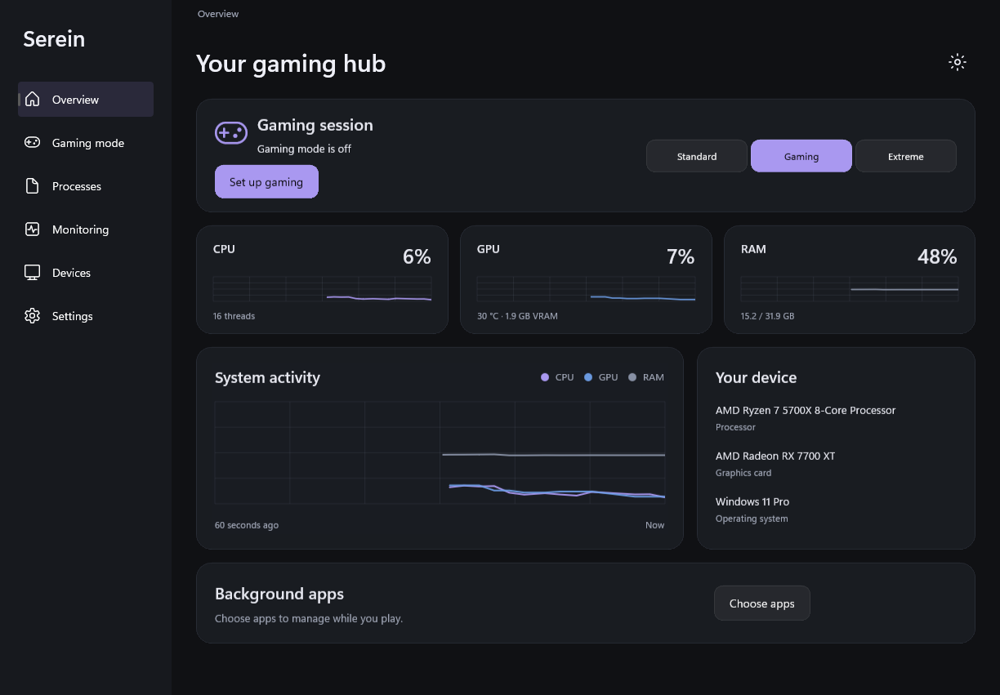
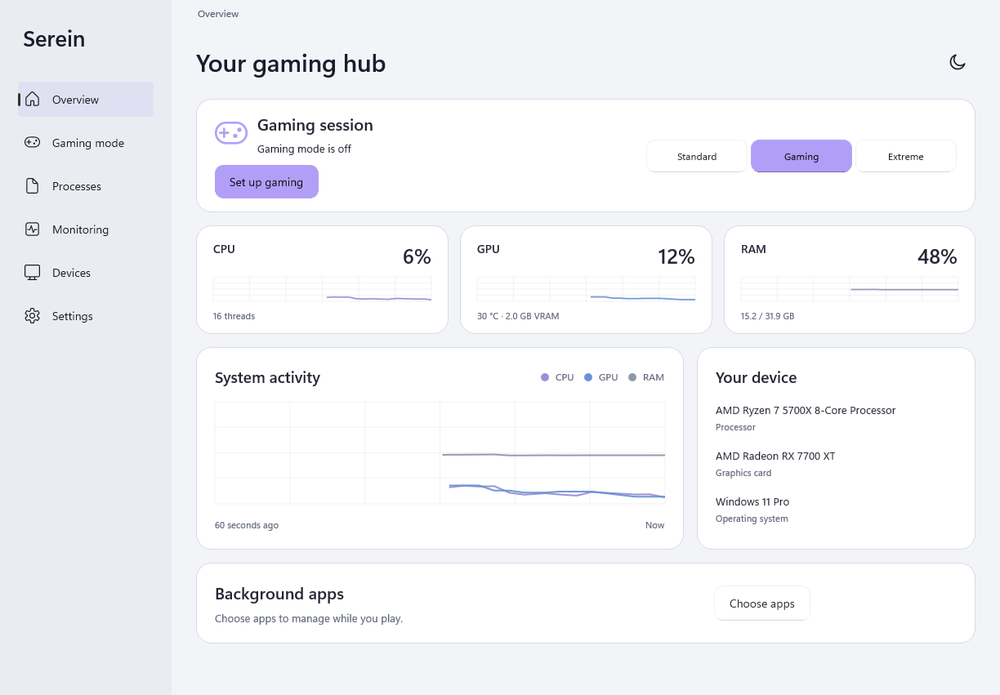
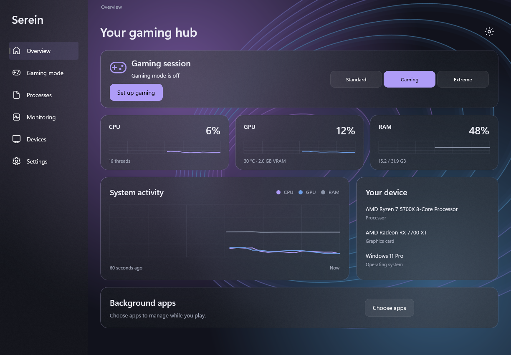
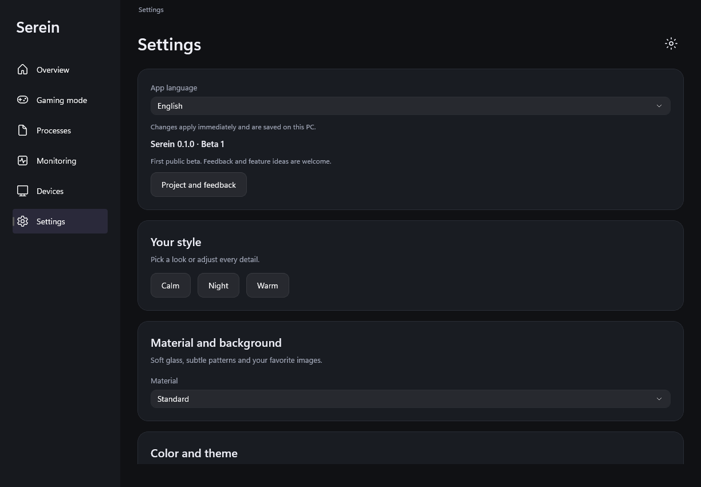

# Serein

**Ein Gaming-Begleiter für Windows. Erste öffentliche Beta — 0.1.0-beta.1.**

[English](README.md) · [Русский](README.ru.md) · [Deutsch](README.de.md)

Serein zeigt die Auslastung deines PCs und verwaltet auf Wunsch ausgewählte
Hintergrund-Apps beim Spielen. Es hilft bei der Geräteerkennung und beim Finden
offizieller Treiberunterstützung. Ein FPS-Zuwachs wird nicht versprochen:
Das Ergebnis hängt von PC, Spiel und Hintergrundlast ab.

## Herunterladen und starten

1. Öffne [Releases](https://github.com/SonyDew/Serein/releases).
2. Lade unter **Assets** die Datei **Serein-0.1.0-beta.1-win-x64.zip** herunter.
   Die Source-code-Archive sind zum eigenen Kompilieren gedacht.
3. Entpacke das **gesamte ZIP**. Alle Dateien müssen im selben Ordner bleiben.
4. Starte **Serein.Gaming.WinUI.exe**. Eine separate .NET-Installation ist nicht nötig.

Getestet auf **Windows 11, 64-Bit**. Windows 10 ist noch nicht validiert. Die Beta
ist nicht digital signiert; Windows kann einen unbekannten Herausgeber melden.
Der Release enthält eine SHA-256-Prüfsumme für den Download.

## Vorschau

Echte Screenshots der Beta. Die Messwerte stammen vom Test-PC.



| Helles Design | Optionales Liquid Glass |
| --- | --- |
|  |  |



## Bereits verfügbar

- CPU-, GPU- und Speicherauslastung, Diagramme, Datenträger- und Netzwerkaktivität.
  Nicht verfügbare Sensoren zeigen keine erfundenen Messwerte.
- Spiel und erlaubte Hintergrund-Apps auswählen. Gaming senkt ihre Priorität;
  Extrem friert sie vorübergehend ein.
- **Alles zurücksetzen**, Wiederherstellung bei Spielende/Zeitablauf und ein
  separater Überwachungsprozess. Windows- und Spielabhängigkeiten sind geschützt.
- Manuelle Aktionen für geeignete Prozesse.
- Geräte- und Treiberinformationen, getrennte SSD-Firmwareanzeige, Windows-Update-Suche
  und relevante offizielle Herstellerseiten.
- Designs, Akzentfarben, Panel-Formen, Textgröße, Dashboard-Blöcke, Bilder und
  optionale animierte Glasmuster.
- **Englisch, Russisch und Deutsch.** Englisch ist voreingestellt. Ändere die
  Sprache unter **Settings → App language**, ohne Neustart.

## Hinweise zur Beta

Das ist Beta 1. Fehler und fehlende Funktionen sind zu erwarten. Beginne mit der
Überwachung. Friere nur Apps ein, die du sicher pausieren kannst: Downloads und
Dateispeicherung halten an, gemeinsame Ressourcen können blockiert werden.
Wiederherstellung ist getestet, aber nicht bei jedem Windows- oder PC-Ausfall garantiert.

Die Treibersuche installiert nichts. Zur Installation öffnet sich Windows Update,
wo du selbst auswählst. Ein leeres Ergebnis bedeutet nicht, dass alle Treiber aktuell
sind. Die Geräteerkennung hat einen begrenzten Katalog. Keine SSD-Firmwareinstallation.

AMD-GPU-Sensoren nutzen vorhandene unterstützte Treiber. CPU-Temperatur braucht die
separate unterstützte AMD-Messkomponente und eine ausdrücklich erlaubte Verbindung
mit Administratorrechten. AMD-Komponenten liegen nicht bei. Andere Hardware kann
weniger Messwerte liefern.

Der Download verwendet **WinUI 3**. Tray, Bereinigung, Autostart-/Dienstverwaltung,
integrierte FPS-Aufzeichnung und der vollständige Treiberinstaller sind noch nicht
übertragen. Älterer WPF-Code liegt zur Entwicklung bei; seine zusätzlichen Funktionen
sind nicht Teil dieses Downloads.

## Feedback ist willkommen

**Verbesserungsvorschläge und Ideen für neue Funktionen sind ausdrücklich willkommen.**
Du musst nicht programmieren können. [Öffne ein Issue](https://github.com/SonyDew/Serein/issues/new/choose)
und beschreibe Idee oder Fehler. Entferne private Dateipfade, Seriennummern und
persönliche Informationen aus Screenshots.

Auch Codekorrekturen, Übersetzungen und Geräteerkennung helfen.
Siehe [CONTRIBUTING.md](CONTRIBUTING.md).

## Selbst kompilieren

Benötigt: .NET 10 SDK, Windows SDK und Windows-/WinUI-Buildtools von Visual Studio.
In PowerShell im Projektordner:

```powershell
powershell -NoProfile -File experiments/Serein.Gaming.WinUI/build.ps1 -Test
```

Die Anwendung liegt unter `artifacts/Serein-Gaming-WinUI/`.
Weitere Details: [Beta-Hinweise](docs/releases/v0.1.0-beta.1.md).

Originalcode und eigene Assets: **GPL-3.0-only**, siehe [LICENSE](LICENSE).
Abhängigkeiten behalten eigene Lizenzhinweise im Ordner `licenses`.
